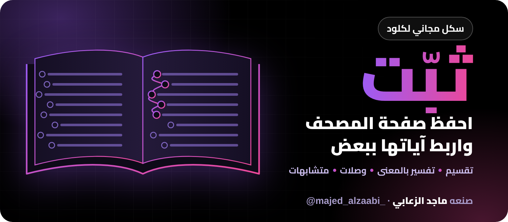

<p align="center">
  
</p>

<p align="center">
  <a href="https://github.com/majedphotos/thabbit-quran-hifz/raw/main/thabbit-quran-hifz.zip">
    
  </a>
</p>

# ثبّت — سكل لحفظ صفحة من المصحف وربط آياتها

سكل لكلود يساعدك تحفظ صفحة من المصحف. ترسل له صورة الصفحة، ويرجع لك بتقسيم جاهز، وتفسير بالمعنى، وخيوط تربط كل آية بالتي بعدها، وربط الصفحة بما قبلها وما بعدها، والمتشابه مع الفرق بينه.

صنعه ماجد الزعابي (@majed_alzaabi_ على انستقرام). مجاني، وغير تابع لترتيل.

## شنو يعطيك؟

- تقسيم الصفحة إلى أقسام صغيرة (2 إلى 4 آيات)، لكل قسم عنوان وتفسير مختصر بالمعنى (الميسر والسعدي).
- وصلة بين كل آيتين بخيوط تمنعك توقف عند الانتقال: كلمة مشتركة، تقابل، تغيّر موضوع، خاتمة ومطلع.
- ربط أول الصفحة بآخر الصفحة اللي قبلها، وآخرها بأول الصفحة اللي بعدها.
- المتشابه: العبارة، ومواضعها بترتيب المصحف، والفرق بينها.
- خريطة ذهنية للصفحة، واختبار على الوصلات إذا طلبته.

كل آية تُجلب من كونكتر ترتيل فقط، ولا تُكتب من الذاكرة.

## المتطلبات

- حساب كلود (المجاني يكفي).
- تنفيذ الأكواد وإنشاء الملفات يكون مفعّل، لأن السكلات تحتاجه.
- كونكتر ترتيل.

## الخطوات

### 1. تأكد من تفعيل تنفيذ الأكواد

الخيار هذا غالباً يكون مفعّل أصلاً، وما سويت له شي بنفسك. بس تأكد: افتح الإعدادات ثم القدرات، وشوف خيار «تنفيذ الأكواد وإنشاء الملفات». إذا كان مفعّل فما عليك شي، وإذا كان مطفي فشغّله.

```
Settings > Capabilities
```

### 2. أضف كونكتر ترتيل

من الكونكترز اختر إضافة كونكتر مخصص، وحط هذا الرابط:

```
https://mcp.tarteel.ai/mcp
```

أو افتح صفحة ترتيل، وفيها زر يضيفه لك جاهز:

```
https://mcp.tarteel.ai/docs/
```

الحساب المجاني له كونكتر مخصص واحد فقط، وهو يكفي هنا.

### 3. حمّل السكل وارفعه

اضغط زر **حمّل السكل** اللي في أعلى الصفحة، وينزل لك الملف المضغوط مباشرة.

لو الزر ما اشتغل معك، افتح الملف من قائمة الملفات في هذه الصفحة:

```
thabbit-quran-hifz.zip
```

واضغط زر التنزيل (السهم) في صفحة الملف.

بعدها ارفعه في كلود من:

```
Customize > Skills
```

### 4. جرّبه

افتح محادثة جديدة وارسل صورة صفحة من المصحف، أو اكتب مثلاً:

```
ثبّت لي سورة المائدة من آية 58 إلى 64
```

أو سؤال عن وصلة وحدة:

```
كيف أربط آية 62 بآية 63 في سورة المائدة؟
```

## ملاحظات مهمة

- الخيوط اللي بين الآيات ربط ذهني من السكل لتسهيل الحفظ، مو من التفسير، وهو ينبّهك لذلك.
- المتشابه يجي من بحث نصي في ترتيل: يعرض المواضع اللي لقيها، وما هو قائمة متشابهات رسمية كاملة. راجع مصحفك.
- أرسل صورة الصفحة دائماً. لو اكتفيت برقم الصفحة أو اسم السورة، حدود الصفحة تكون تقديرية، وممكن تختلف آية عن مصحفك.
- السعدي أحياناً يرجع من الأداة بلغة ثانية، فالسكل ينقل معناه بالعربي وينبّهك.
- لو وقف السكل وقال إن أدوات ترتيل ما توفرت، فالكونكتر مو مفعّل في المحادثة. فعّله من الكونكترز وجرّب مرة ثانية.
